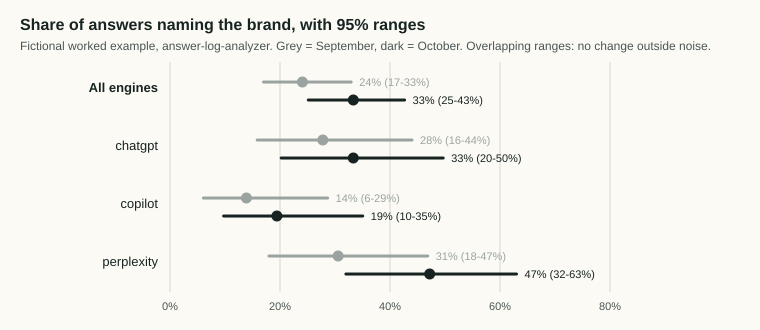

# GEO skills

[](https://github.com/aivisibilitycensus/geo-skills/actions/workflows/tests.yml) [](LICENSE) [](LICENSE-docs)

Open skills for Claude and other AI assistants that help you measure and check how a business appears in AI search. Built on the published method of the [AI Visibility Census](https://aivisibilitycensus.com/methodology/).

Most GEO tools give you a score. These skills give you counts you can trace back to data, say how sure the data lets you be, and grade every tactic by the evidence behind it. None of them promise that a business will be named, and none of them use hidden instructions or tricks aimed at AI systems.

## Start here

Check one page, no account and nothing to install beyond Python 3:

```
git clone https://github.com/aivisibilitycensus/geo-skills
python3 geo-skills/geo-check/scripts/geo_check.py https://example.com/your-page
```

You get a short list of what stops AI search engines from reading that page, each item with the evidence behind it. [Example output](geo-check/examples/output-report.md). There is no score out of 100, on purpose: whether audit scores go with being named by AI is an open question, and we are [testing it in public](validation/SV-001-protocol.md).

## See it work

The answer log analyzer on its worked example (a fictional Dublin accounting firm, 108 logged answers a month on three engines):



| Engine | Named, September | Named, October |
|---|---|---|
| chatgpt | 28% (16-44%), n=36 | 33% (20-50%), n=36 |
| copilot | 14% (6-29%), n=36 | 19% (10-35%), n=36 |
| perplexity | 31% (18-47%), n=36 | 47% (32-63%), n=36 |

A nearly 17-point jump on one engine, and the report says it is not outside the noise. That is the point of these skills: counts with ranges, not a score. Full output: [answer-log-analyzer/examples/example-report.md](answer-log-analyzer/examples/example-report.md).

If a skill saves you time, star the repo. Stars are how other people find it.

## Skills

| Skill | What it does | Needs |
|---|---|---|
| [geo-check](geo-check/) | One command: can AI search reach and read this page? Page response, noindex, robots.txt for 11 crawler tokens, text without JavaScript, structured data, firewall hints. Findings in four tiers with evidence grades | A URL |
| [question-set-builder](question-set-builder/) | Builds a fixed set of buyer questions with stable IDs, spread across buying intents, for tracking AI visibility | Nothing |
| [answer-collector](answer-collector/) | Runs the question set on ChatGPT, Gemini, Google AI Overviews, AI Mode and Copilot with repeats, and logs every answer and cited URL | Your own DataForSEO or SerpApi key |
| [answer-log-analyzer](answer-log-analyzer/) | Reads logged AI answers from repeated runs and reports named, cited, cited-but-someone-else-named and absent, with run-to-run variance and an honest month-on-month comparison | A CSV of answers (from answer-collector, a tracker export or a manual log) |
| [schema-parity-checker](schema-parity-checker/) | Checks that a page's structured data says only what the visible page says: FAQ text, prices, ratings, contact details, dates | A URL or saved HTML |
| [geo-migration-guard](geo-migration-guard/) | Protects AI search visibility through a site migration: baseline, redirect map check, post-launch parity, robots.txt changes for AI crawlers | URL lists and a redirect map |
| [ai-crawler-log-check](ai-crawler-log-check/) | Analyzes server logs for AI and search crawlers and verifies them against published IP ranges and reverse DNS, so spoofed bots are not counted | Access logs |
| [content-shape-checker](content-shape-checker/) | Checks whether a draft is built like human writing or generated text (over-explanation, named specifics, scaffold variance, profundity inflation) and quotes every sentence to fix. Also available as a [free web tool](https://aivisibilitycensus.com/content-shape-checker/) | A draft with headings |
| [geo-experiment-kit](geo-experiment-kit/) | Templates and a readout script for running one-change-at-a-time SEO and GEO experiments with control pages and recorded predictions | Nothing |

## Templates

Free spreadsheets in [templates/](templates/): an [SEO report template with AI visibility](https://aivisibilitycensus.com/templates/seo-report-template/) (95% ranges on every AI rate), a [GEO checklist graded by evidence](templates/geo-checklist.md), and an [AI Overview CTR loss finder](https://aivisibilitycensus.com/templates/ai-overview-ctr-loss/) for Search Console data.

Every recommendation carries an evidence grade from [tactics/EVIDENCE.md](tactics/EVIDENCE.md): tested by the Census, published study, platform documentation, vendor claim, or untested.

The scripts are Python 3 and use the standard library only (schema-parity-checker can optionally render pages with Playwright). Each skill with a script has a worked example built from synthetic data, with the real script output, and tests that run on every push.

## Install

**Claude (claude.ai or the desktop app):** zip a skill folder, then in Settings > Capabilities turn on code execution, scroll to Skills, click "Upload skill" and choose the zip. [Anthropic's guide](https://support.claude.com/en/articles/12512180-using-skills-in-claude) has the details.

**Claude Code (plugin, all nine skills):**

```
/plugin marketplace add aivisibilitycensus/geo-skills
/plugin install geo-skills@geo-skills
```

On Claude Code 2.1.275 or later, one step: `/plugin install geo-skills --marketplace aivisibilitycensus/geo-skills`.

**Claude Code (one skill):** copy the skill folder into `~/.claude/skills/` (personal) or `.claude/skills/` in a project. Copy `tactics/` alongside the skills so the evidence links resolve.

**Other assistants:** each `SKILL.md` is plain markdown. Paste it into a custom GPT, a Gem or a project's instructions. The scripts run on their own from the command line.

## A typical workflow

1. Run **geo-check** on the pages you want named, and fix anything that blocks.
2. Build the questions with **question-set-builder**.
3. Collect answers with **answer-collector**: at least three per question, per engine, per check date.
4. Analyze the log with **answer-log-analyzer**.
5. Fix what the data points to, one change at a time, using **geo-experiment-kit**.
6. Check drafts with **content-shape-checker** before they ship.
7. Use **schema-parity-checker**, **ai-crawler-log-check** and **geo-migration-guard** for the deeper technical checks.

## Open studies

Run in this repository, registered before the data exists, published whichever way they come out:

- [SV-001](validation/SV-001-protocol.md): do GEO audit scores go with being named by AI? Two open-source scoring scripts against Census100 answer data for 20 project management brands. Registered 10 November 2026.
- [VS-001](validation/VS-001-protocol.md): how often does the Content Shape Checker flag articles written by people?

## License

Code is [MIT](LICENSE). Skill text, evidence grades, templates, examples and data are [CC BY 4.0](LICENSE-docs): reuse them, including commercially, with credit to the AI Visibility Census. [LICENSING.md](LICENSING.md) says which files are which.

## Feedback

Open an issue, or email hello@aivisibilitycensus.com. If a grade in the evidence file is wrong, send the source.
